<div align="center">

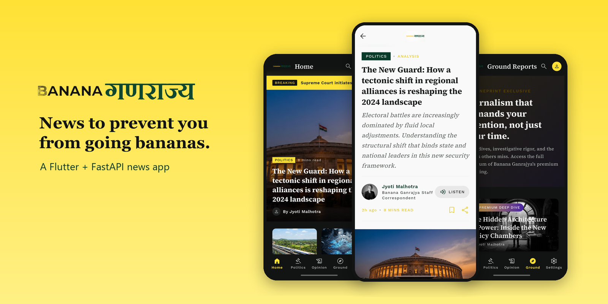

# Banana Ganrajya

*News to prevent you from going bananas.* 🍌

**An editorial-grade news reader for Android & iOS: Flutter on the front, FastAPI on the back.**

[](https://flutter.dev)
[](https://dart.dev)
[](https://riverpod.dev)
[](https://fastapi.tiangolo.com)
[](https://auth0.com)
[](LICENSE)

<a href="https://github.com/silverstone-git/banana-ganrajya/releases/latest/download/banana-ganrajya.apk"></a>

<sub>Android 7.0+ · <a href="https://github.com/silverstone-git/banana-ganrajya/releases/latest">release notes</a></sub>

</div>

---

## Screenshots

<table>
  <tr>
    <td align="center">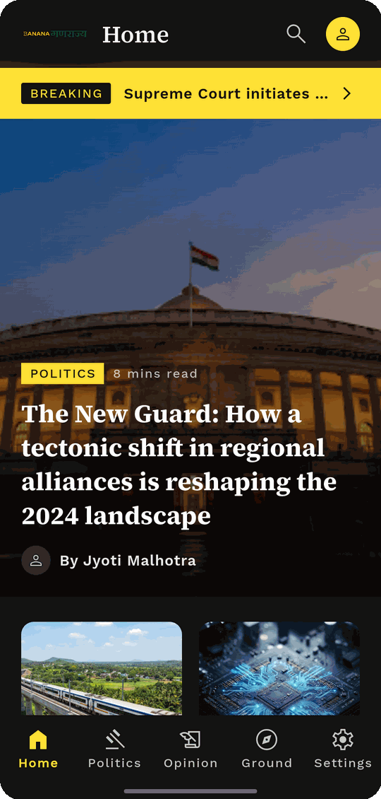<br><sub><b>Home</b> · breaking ticker & hero story</sub></td>
    <td align="center">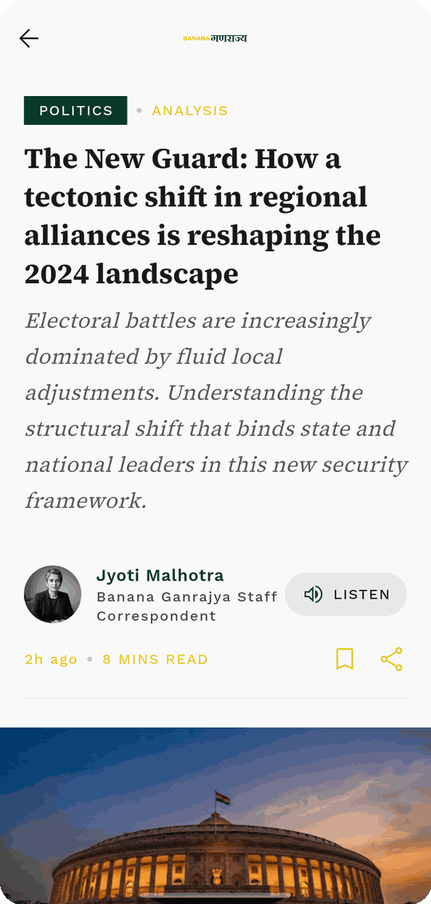<br><sub><b>Article</b> · byline, listen, bookmark</sub></td>
    <td align="center">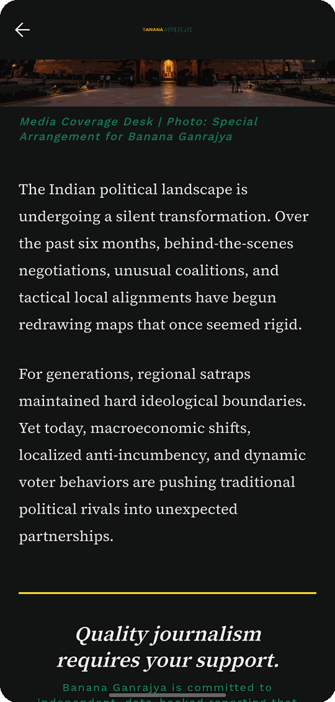<br><sub><b>Reader</b> · serif long-form body</sub></td>
    <td align="center">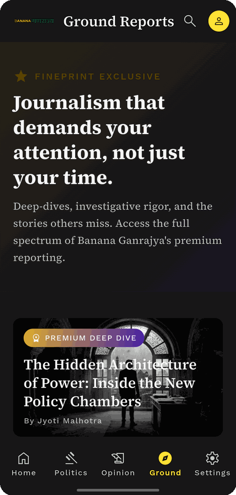<br><sub><b>Ground Reports</b> · premium FinePrint tab</sub></td>
  </tr>
  <tr>
    <td align="center">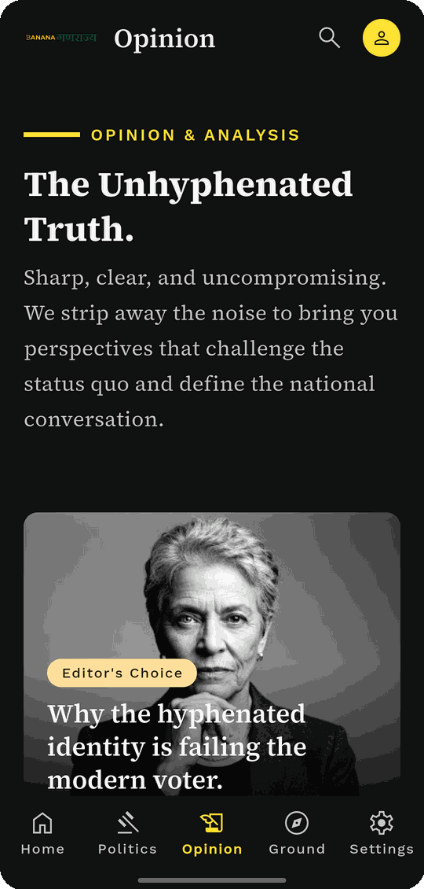<br><sub><b>Opinion</b> · columns & editor's choice</sub></td>
    <td align="center">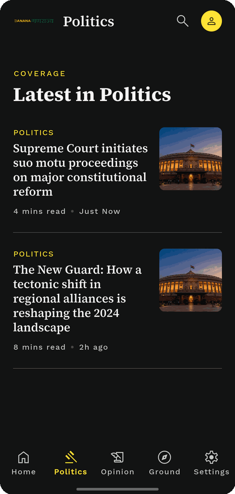<br><sub><b>Politics</b> · section feed</sub></td>
    <td align="center">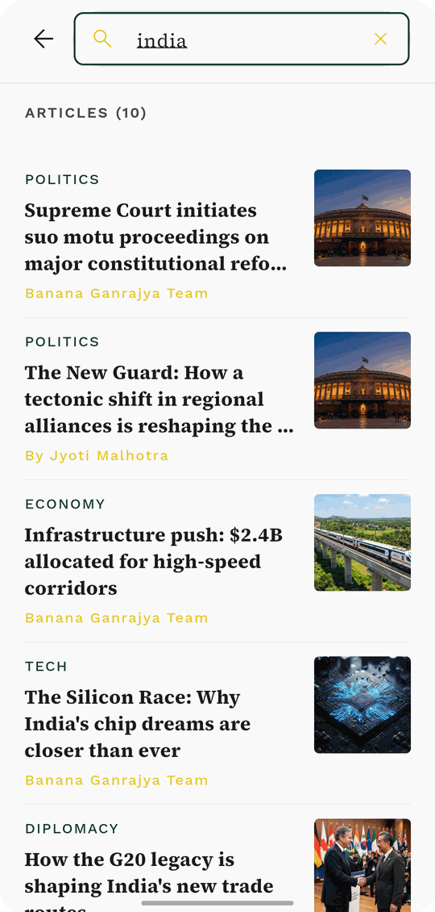<br><sub><b>Search</b> · topics, authors, articles</sub></td>
    <td align="center">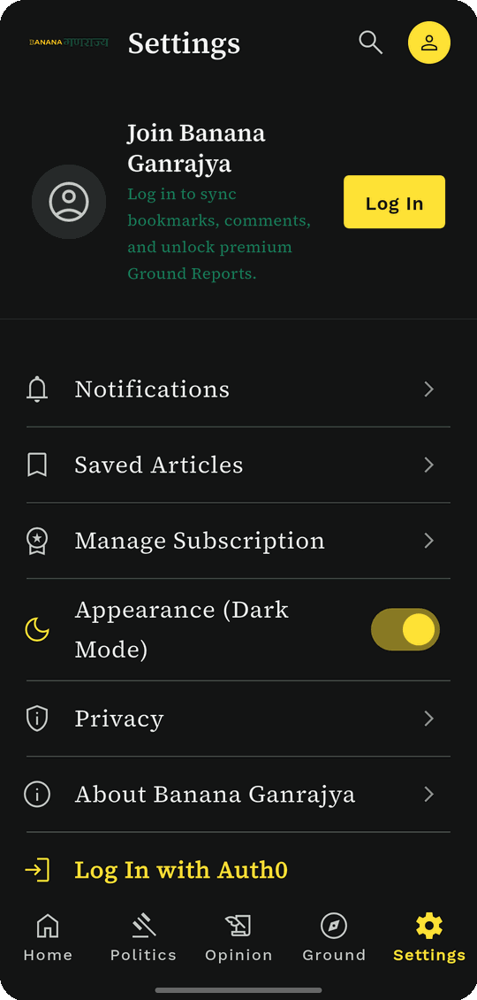<br><sub><b>Settings</b> · Auth0 login & theme</sub></td>
  </tr>
</table>

<details>
<summary><b>Light ↔ dark</b>: every screen ships both palettes</summary>
<br>
<p align="center">
  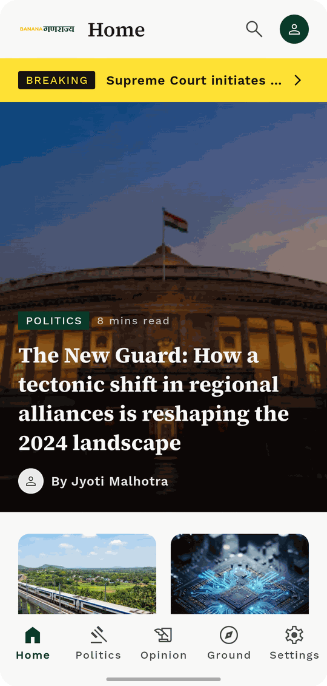
  &nbsp;
  
  &nbsp;
  
  &nbsp;
  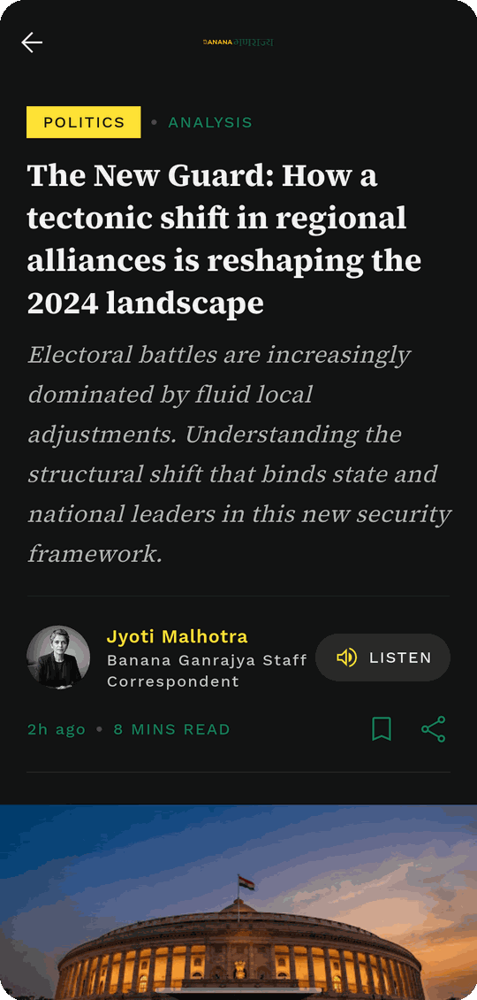
</p>
</details>

---

## Features

| | |
|---|---|
| 📰 **Five-tab news shell** | Home, Politics, Opinion, Ground Reports and Settings, each with its own navigation stack (`StatefulShellRoute`) and pull-to-refresh. |
| 🎨 **Editorial design system** | Source Serif 4 headlines, a banana-yellow / deep-green palette, frosted app bars, and a gold-to-purple *FinePrint* gradient reserved for premium content. Dark by default, with a light mode one tap away. |
| 🔊 **Listen to any article** | Articles are narrated server-side with Google Cloud TTS (Neural2 voice), stored on Cloudflare R2, and streamed in-app. Falls back to on-device TTS. |
| 🔍 **Global search** | Debounced search grouped into topics, columnists and articles, with recent queries kept on the device. |
| 💬 **Threaded discussions** | Nested comment trees under every story; posting is gated behind Auth0 login. |
| 🔖 **Synced bookmarks** | Optimistic UI that syncs with the backend and rolls back if the network fails. |
| ✍️ **Publishing desk** | A Quill.js rich-text editor served by FastAPI at `/api/admin/publish`, with image uploads to R2 and automatic audio generation. |
| 📈 **Read telemetry** | Scroll depth and time-on-article sent to the backend without blocking the reader. |

---

## Architecture

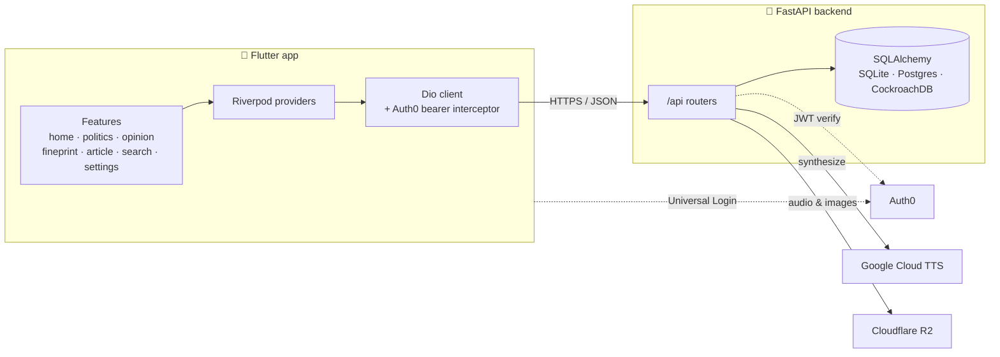

The app follows a **feature-first, layered** layout:

```
lib/
├── core/            # theme & palettes, router, network config, shared widgets, providers, models
└── features/
    ├── home/        politics/    opinion/
    ├── fineprint/   # Ground Reports (premium)
    ├── article/     # reader, author profiles, comments, audio
    ├── search/
    └── settings/    # login, theme toggle, admin publisher panel

backend/
├── app/
│   ├── api/routers/ # feeds, articles, comments, bookmarks, search, payments, admin
│   ├── core/        # settings (pydantic-settings), Auth0
│   ├── db/          # SQLAlchemy models & session
│   └── seed.py      # demo newsroom content
└── alembic/         # migrations
```

---

## Getting started

### Prerequisites

- Flutter **3.44+** (Dart 3.12)
- Python **3.11+**
- An [Auth0](https://auth0.com) tenant if you want login. The feeds work without one.

### 1. Backend

```bash
cd backend
python -m venv .venv
source .venv/bin/activate          # Windows: .venv\Scripts\activate
pip install -r requirements.txt

cp .env.example .env               # then fill it in
```

> [!IMPORTANT]
> `ADMIN_API_KEY` is **required** and has no default. The server won't start without it.
> Generate one with:
> ```bash
> python -c "import secrets; print(secrets.token_urlsafe(48))"
> ```

```bash
alembic upgrade head               # create the schema
python -m app.seed                 # load the demo newsroom
uvicorn app.main:app --reload --port 8000
```

Interactive API docs are then available at <http://localhost:8000/docs>.

**Or with Docker:** `docker compose up --build -d` from `backend/`. The container runs migrations and seeding on boot (see `start.sh`).

### 2. App

```bash
flutter pub get
flutter run
```

Where the app sends API requests is set in [`lib/core/network/api_config.dart`](lib/core/network/api_config.dart):

| Build | Base URL |
|---|---|
| **Release** | `releaseBaseUrl`, the production domain |
| **Debug** | Looked up at startup: the app queries a short-link (`sh.aryan.cfd/localtesting`) that 301-redirects to whatever ngrok tunnel is running on the dev machine. Re-point the link and every phone follows, with no rebuilds. |

To use your own backend, change those two constants, or run `adb reverse tcp:8000 tcp:8000` and point them at `http://127.0.0.1:8000`.

### 3. Checks

```bash
flutter analyze
flutter test
```

---

## Documentation

| Doc | What's inside |
|---|---|
| [Developer guide](docs/DEVELOPER_GUIDE.md) | Architecture rules, design tokens, navigation, and a log of bugs fixed so far |
| [Architecture](docs/ARCHITECTURE.md) | Backend and Auth0 integration, GCP TTS + Cloudflare R2 setup, the publishing desk |
| [Database migration](docs/DATABASE_MIGRATION.md) | Moving from SQLite to Postgres/CockroachDB, plus diagnostic scripts |

---

## Roadmap

- [ ] Paytm checkout for FinePrint subscriptions (endpoints currently return mock tokens)
- [ ] Full offline mode with cached bookmarked articles
- [ ] Original artwork for story imagery

---

## License

[MIT](LICENSE) © silverstone-git

<sub>Story images in the demo seed data are placeholder renders from early Google Stitch mockups.</sub>
